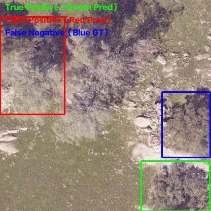

# 🌳 Tree Counting Using Drone Images

An AI-powered computer vision project for detecting and counting trees from aerial drone imagery using **Ultralytics YOLOv11**.

---

# 📌 Project Overview

Traditional manual tree counting is extremely time-consuming, labor-intensive, and highly prone to human error. This project fully automates this process by leveraging deep learning-based object detection on top-view drone imagery.

The system is designed to detect individual tree canopies, estimate the total number of trees, and provide a scalable solution for forestry, plantation management, agriculture, and environmental monitoring.

---

# 🎯 Objectives

- Automatically detect trees from drone images.
- Count the total number of trees.
- Train a robust YOLOv11 object detection model.
- Evaluate model performance using standard object detection metrics.
- Build a complete and reproducible deep learning pipeline.

---

# 🛠 Technology Stack

| Category | Technology |
|-----------|------------|
| Programming Language | Python 3.x |
| Deep Learning | PyTorch |
| Object Detection | Ultralytics YOLOv11 |
| Image Processing | OpenCV |
| Data Analysis | NumPy, Pandas |
| Visualization | Matplotlib |
| Development | VS Code, Jupyter Notebook |
| Version Control | Git & GitHub |

---

# 📂 Dataset

**Dataset Name:** Tree-Top-View Dataset  
**Source:** Roboflow Universe  
**Task:** Object Detection  
**Classes:** `tree-top` (1 class)  

**Splits:**
- **Training Set:** 1191 images
- **Validation Set:** 116 images
- **Test Set:** 55 images

**License:** CC BY 4.0  

**Dataset Location:**
```text
datasets/Tree-Top-View/
```

---

# 📁 Repository Structure

```text
TreeCountingUsingDroneImages/
│
├── assets/
│
├── datasets/
│   └── Tree-Top-View/
│       ├── train/
│       │   ├── images/
│       │   └── labels/
│       ├── valid/
│       │   ├── images/
│       │   └── labels/
│       ├── test/
│       │   ├── images/
│       │   └── labels/
│       ├── data.yaml
│       ├── README.dataset.txt
│       └── README.roboflow.txt
│
├── docs/
│
├── models/
│   └── checkpoints/
│
├── notebooks/
│
├── outputs/
│   ├── metrics/
│   ├── predictions/
│   └── visualizations/
│
├── scripts/
│
├── src/
│   ├── train.py
│   ├── predict.py
│   ├── evaluate.py
│   ├── visualize.py
│   └── utils.py
│
├── requirements.txt
├── .gitignore
└── README.md
```

---

# 🔄 Project Workflow

```text
Drone Images
      │
      ▼
Dataset Preparation
      │
      ▼
Data Exploration
      │
      ▼
Model Training (YOLOv11)
      │
      ▼
Prediction
      │
      ▼
Tree Detection
      │
      ▼
Tree Counting
      │
      ▼
Evaluation
      │
      ▼
Visualization
```

---

# 🚀 Getting Started

## Clone Repository

```bash
git clone git@github.com:Nitheesh-Git/TreeCountingUsingDroneImages.git
cd TreeCountingUsingDroneImages
```

## Create Virtual Environment

```bash
python3 -m venv .venv
source .venv/bin/activate
```

## Install Dependencies

```bash
pip install -r requirements.txt
```

---

# 🏋️ Training

```bash
yolo detect train \
model=yolo11n.pt \
data=datasets/Tree-Top-View/data.yaml \
epochs=100 \
imgsz=640
```

---

# 📈 Evaluation Metrics

- Precision
- Recall
- mAP@0.5
- mAP@0.5:0.95
- Tree Counting Accuracy
- Inference Speed

---

# 📤 Expected Output

- Automatic tree detection
- Automatic tree counting
- Bounding box visualization
- Annotated prediction images
- Performance metrics
- Trained YOLOv11 model

---

# 📊 YOLOv8n Baseline Evaluation

A baseline **YOLOv8n** model was trained on the Tree-Top-View dataset. Training employed early stopping and halted at 26 epochs.

### 🧪 Test-Set Evaluation Results

The model was evaluated against the unseen **55 test images** to establish an unbiased estimate of performance.

| Metric    | Result |
| --------- | -----: |
| Precision | 0.5288 |
| Recall    | 0.6206 |
| mAP50     | 0.6000 |
| mAP50-95  | 0.2914 |

These metrics indicate that while the model correctly identifies a solid majority of actual trees (62% Recall), it is somewhat prone to false positives (53% Precision).

### 🔍 Quantitative Error Analysis

To understand the baseline model's actual detection failures, we performed a strict IoU-based matching analysis (IoU threshold: 0.5) on a subset of **30 validation images**. 

*Note: These results represent this specific subset for visual analysis, not the entire validation dataset.*

- **True Positives (TP):** 166
- **False Positives (FP):** 141
- **False Negatives (FN):** 104
- **Subset Precision:** 0.5407
- **Subset Recall:** 0.6148

> **Important:** The high number of False Positives includes unmatched predictions under our greedy matching algorithm (IoU $\ge$ 0.5). This means "False Positives" include both non-tree objects being detected, as well as duplicate bounding boxes or boxes with poor localization that failed to meet the 50% overlap criteria.

#### Visualizing the Errors

We overlaid the predictions and ground truth to manually inspect the model's behavior:
- 🟩 **Green Boxes:** True Positives (Correct predictions)
- 🟥 **Red Boxes:** False Positives (Wrong predictions or duplicates)
- 🟦 **Blue Boxes:** False Negatives (Actual trees missed by the model)

**Sample Error Analysis Overlay:**


*(You can find all 30 analyzed overlays in the `outputs/predictions/error_analysis/` directory of this repository).*

---

# 📅 Current Project Status

| Phase | Status |
|--------|--------|
| Repository Setup | ✅ Completed |
| Dataset Collection | ✅ Completed |
| Baseline Model Training | ✅ Completed |
| Evaluation Pipeline | ✅ Completed |
| Literature Survey | ⏳ Pending |
| Dataset Analysis | ⏳ Pending |
| YOLOv11 Implementation | 🔄 In Progress (Phase 1 Init Complete) |
| Hyperparameter Tuning | ⏳ Pending |
| Final Presentation | ⏳ Pending |

---


# 👥 Team

| Member | Responsibility |
|----------|----------------|
| Nitheesh | Model Development, Repository Management, Documentation |
| Nishu Kumari | Literature Survey, Dataset Analysis, Documentation |
| Astley | Data Collection, Research, Model Evaluation, Testing |

---

# 📚 References

- Roboflow Universe - Tree-Top-View Dataset
- Ultralytics YOLO Documentation
- PyTorch Documentation

---

# 📄 License

This project uses the **Tree-Top-View Dataset** under the **CC BY 4.0 License**. Please refer to the dataset documentation for attribution requirements.

